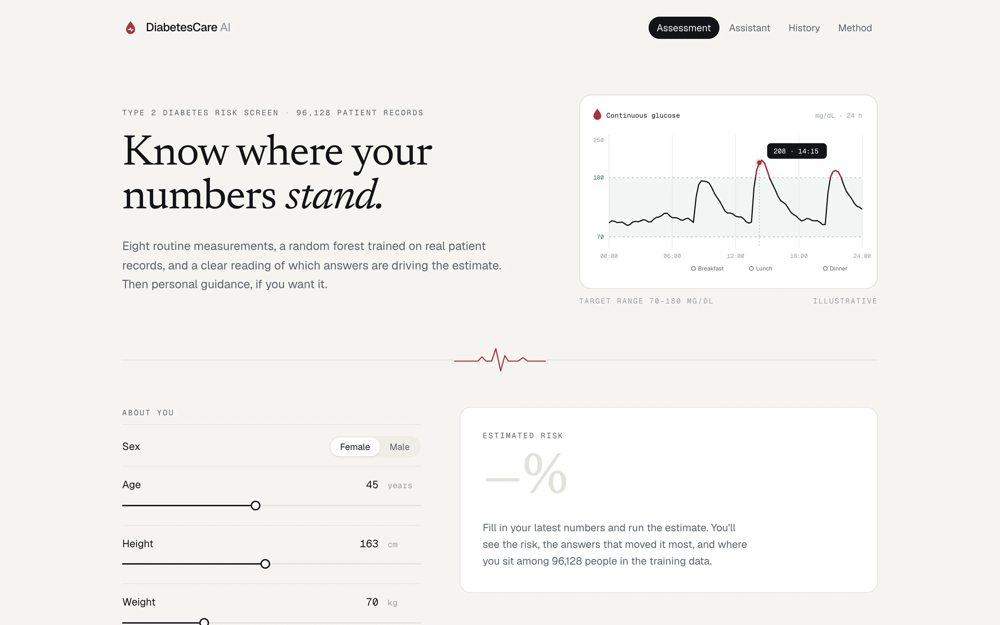
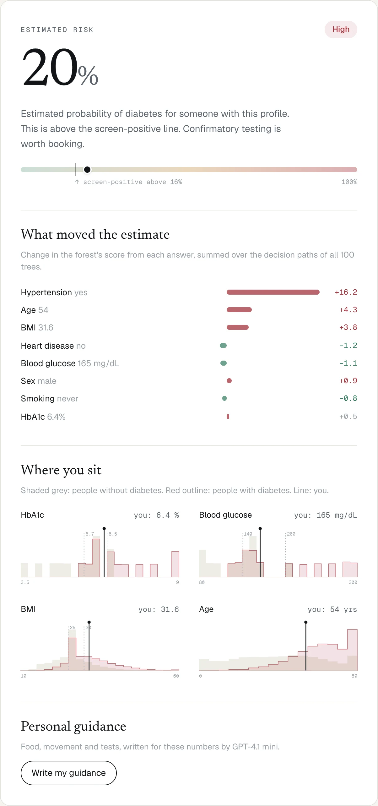
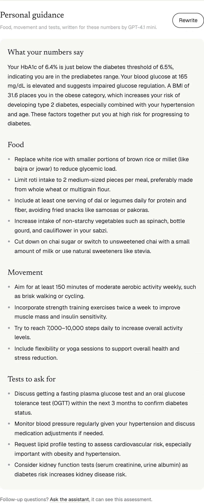

# DiabetesCare AI

Type 2 diabetes risk screening, with an explanation of what drives the estimate and personal guidance.



## What it does

- **Risk estimate.** Eight routine measurements go in. A random forest returns an estimated probability and a risk band.
- **What moved the estimate.** Per-answer attributions computed from the forest's decision paths.
- **Where you sit.** Your HbA1c, glucose, BMI and age plotted against 96,128 patient records.
- **Guidance and assistant.** Personal food, activity and testing guidance, plus a diabetes Q&A assistant (GPT-4.1 mini).
- **History.** Past assessments are saved in the browser, with a trend chart.

<p>
  
  
</p>

## Model

Trained on the [Diabetes Prediction dataset](https://www.kaggle.com/datasets/iammustafatz/diabetes-prediction-dataset) after removing duplicates. SMOTE plus under-sampling handle the class imbalance, and the model is a 100-tree random forest. Scores are on a stratified 20% held-out set:

| Accuracy | ROC AUC | Recall | Precision |
| --- | --- | --- | --- |
| 94.3% | 97.4% | 81.3% | 64.1% |

## Stack

Next.js · TypeScript · Tailwind CSS · scikit-learn · imbalanced-learn · OpenAI API · Vercel

## Run locally

```bash
npm install
echo "OPENAI_API_KEY=sk-..." > .env.local
npm run dev
```

To retrain: `pip install -r ml/requirements.txt && python ml/train.py`

---

The original Streamlit version is on the [`legacy-streamlit`](https://github.com/malharinamdar/DiabetesCare-AI/tree/legacy-streamlit) branch.
